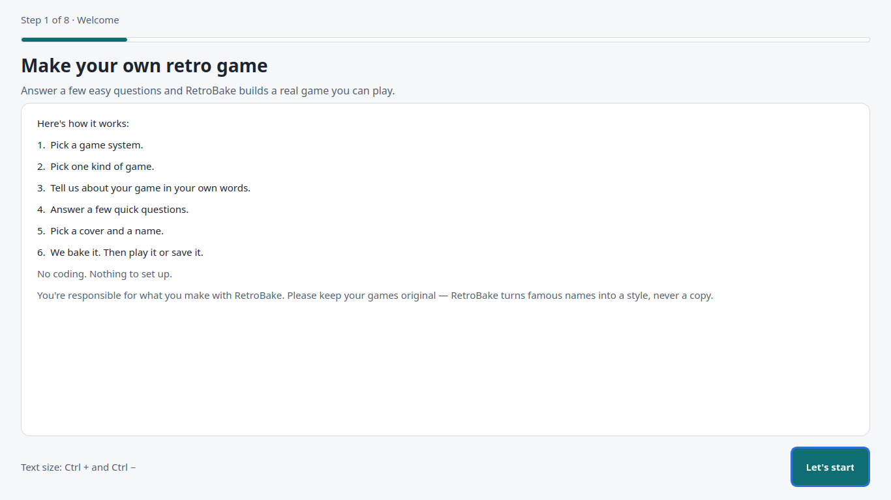
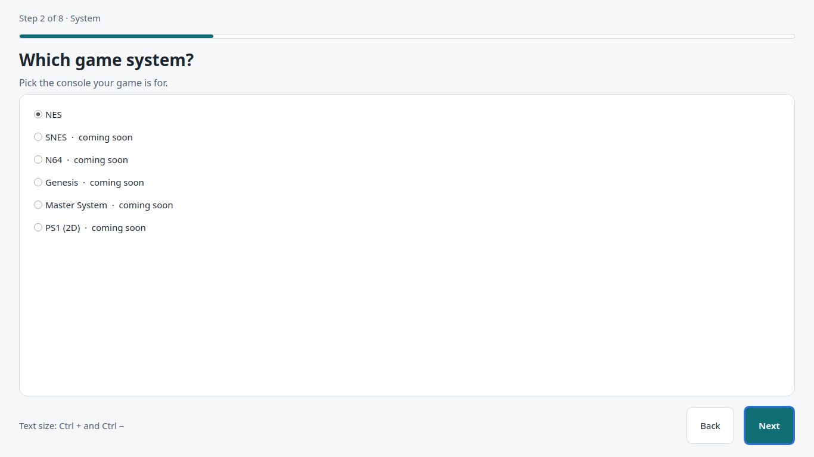
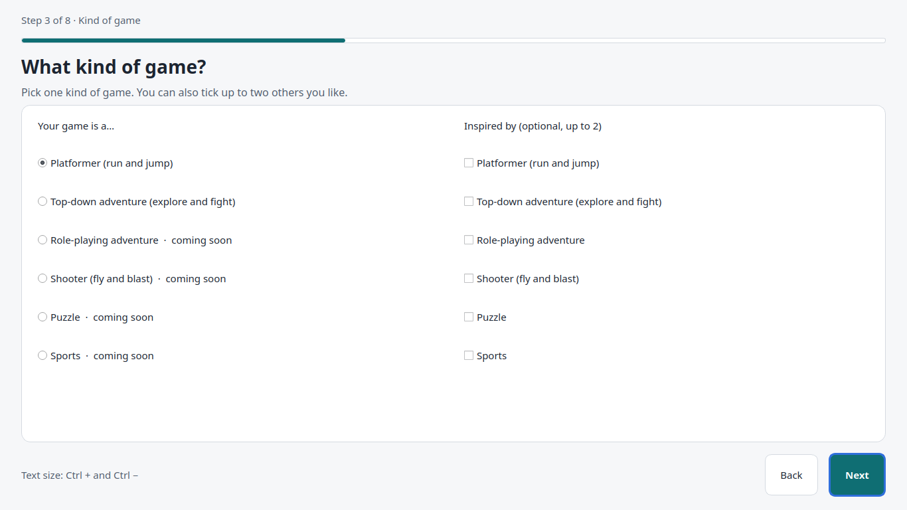
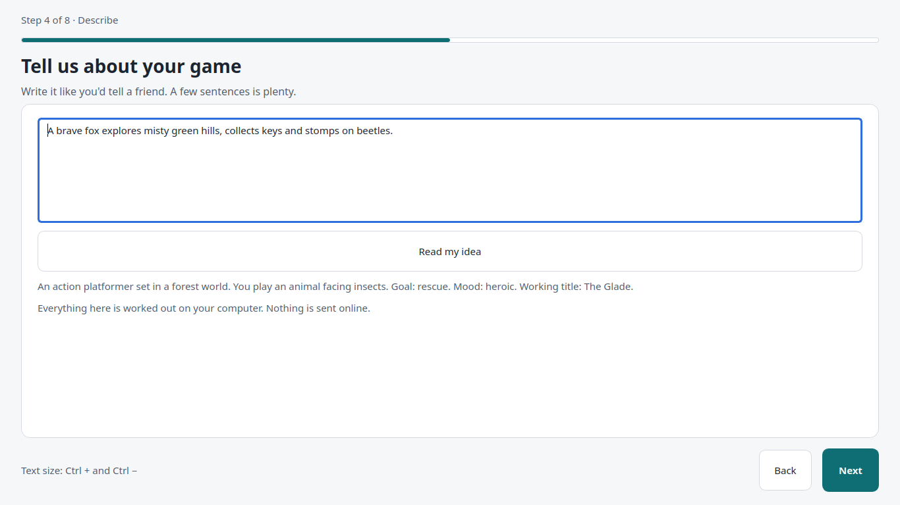
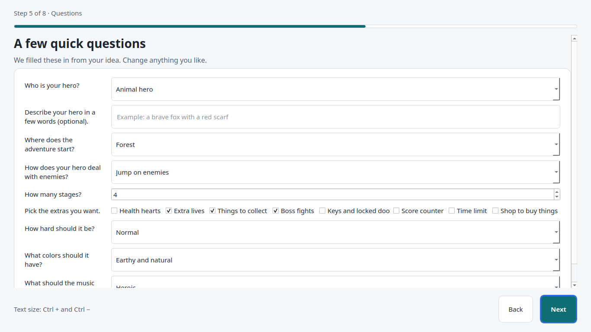
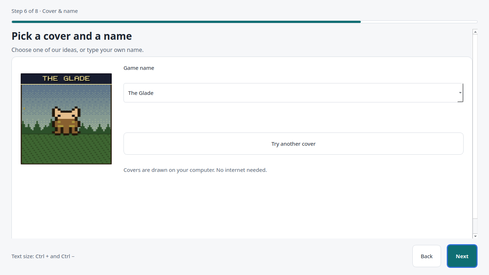
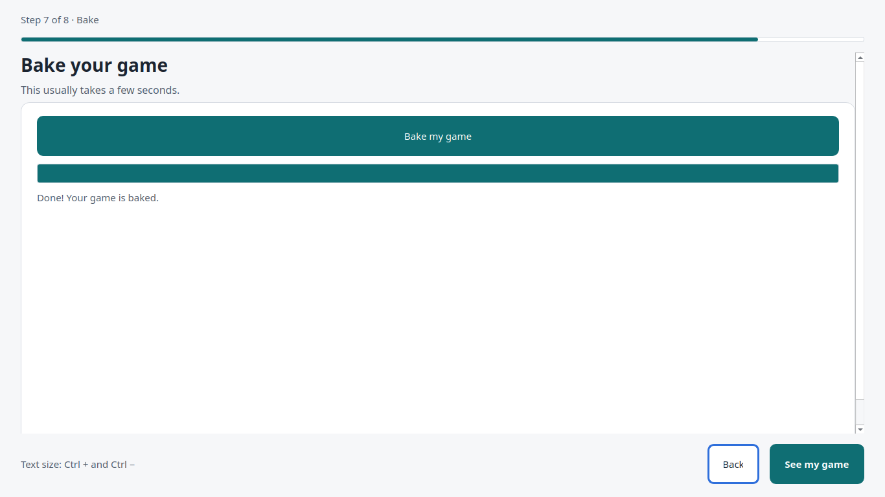
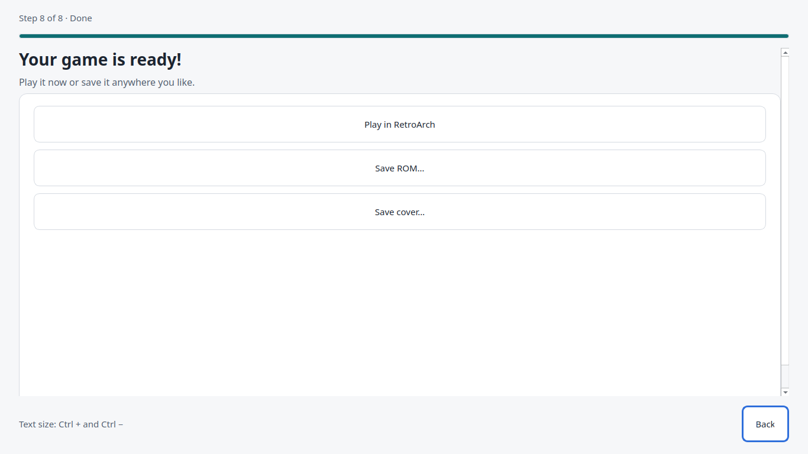
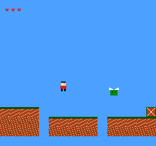

# RetroBake 🍞🎮

**Make your own NES games, no coding needed.**

[](https://github.com/voidwhereprohibited/retrobake/actions/workflows/ci.yml)
[](https://github.com/voidwhereprohibited/retrobake/actions/workflows/codeql.yml)
[](LICENSE)

RetroBake is a free, open-source app for Windows and Linux. You pick a console and a kind
of game, describe your idea in your own words, and answer a few questions. RetroBake then
builds a real ROM file, a game that runs on NES emulators such as RetroArch, and draws a
retro-style cover for it. Everything happens on your computer. You don't need an internet
connection or an account.

> 🚧 **Status: early development (version 0.0.1).** There's no download yet, and only the
> NES platformer makes a full game so far. The details are in [What works today](#what-works-today).



## How it works

| | |
|---|---|
| **1. Pick a system.** NES works today; the others say "coming soon". |  |
| **2. Pick one kind of game.** Each game is one genre. You can name up to two others as inspiration for its style. |  |
| **3. Describe your game** in a sentence or two. RetroBake reads it on your computer and suggests a setting, a hero and a name. |  |
| **4. Answer a few questions:** number of levels, difficulty, hero and setting. Your description fills them in already. |  |
| **5. Pick a cover and a name.** Covers are drawn on your computer; you can try another or type your own name. |  |
| **6. Bake it.** This takes a few seconds. |  |
| **7. Play it** in RetroArch, or save the ROM and the cover anywhere you like. |  |

Here's a baked platformer running in the FCEUmm emulator (the one RetroArch uses), the way
it looks at the start of level 1:



## What works today
- **NES platformer:** a complete little game. It has a title screen, smooth side
  scrolling, jumping, platforms, spikes and pits, and enemies that walk or patrol. You can
  stomp on enemies if your game has "Jump on enemies" combat; otherwise you have to dodge
  them. You get three lives, plus keys and doors, and several levels that end at a goal
  flag. The music is a short placeholder tune.
- **NES top-down adventure:** you can pick it, but for now the ROM only shows your game's
  title screen. The adventure engine isn't written yet.
- **SNES, N64, Genesis, Master System, PS1:** not available yet. SNES is the next one.
- **Not done yet:** coins, hearts, extra lives, bosses and shops appear in the level plans
  but aren't in the game yet. There's no installer release, and the files aren't code-signed.

## Try it from source
For now you need Python 3.12 or newer:

```sh
git clone https://github.com/voidwhereprohibited/retrobake.git
cd retrobake
python -m venv .venv && . .venv/bin/activate      # Windows: .venv\Scripts\activate
pip install -e .
bash tools/build_cc65.sh                           # builds the NES assembler (Linux)
python -m retrobake.ui
```

`tools/build_cc65.sh` builds cc65's assembler and linker from a pinned, checksum-verified
source archive into `toolchains/cc65`. If you already have cc65 installed, you can skip that
step and set `RETROBAKE_CC65_DIR` to the folder that holds `ca65` and `ld65`.

## Downloads (planned for 0.1)
- **Windows:** `RetroBake-Setup-<version>.exe`, an installer that doesn't need admin rights.
- **Linux:** `RetroBake-<version>-x86_64.AppImage`. Download it, mark it as executable,
  and double-click it.

CI already builds both from `packaging/build.py`, with a `SHA256SUMS` file. Releases will
appear on the [Releases page](https://github.com/voidwhereprohibited/retrobake/releases).

## What you need
- Windows 10/11 or a modern 64-bit Linux.
- [RetroArch](https://www.retroarch.com/) (free) to play your games. Any NES emulator that
  runs mapper-0 ROMs works too.

## Original games only
RetroBake makes **original** games. It won't use copyrighted characters, names or artwork,
and it rejects names that copy famous games. You can describe a *style*, for example "a
cheerful run-and-jump game in a snowy forest", and RetroBake makes up its own hero and world.

**Disclaimer:** you're responsible for what you make and share with RetroBake. RetroBake
isn't affiliated with or endorsed by any game company. Generated names and art can sometimes
look like existing work by accident, so check before you share.

## Security
Builds run in a locked-down sandbox, and everything you type is checked before it gets
anywhere near the build tools. Found a security problem? Please report it privately; see
[SECURITY.md](SECURITY.md).

## Contributing
Contributions are welcome. See [CONTRIBUTING.md](CONTRIBUTING.md), the
[Code of Conduct](CODE_OF_CONDUCT.md) and `docs/` (start with `docs/PLAN.md`). To run the
tests, use `pip install --require-hashes -r requirements/dev.txt`, then
`pip install --no-deps --no-build-isolation -e .` and `pytest`. Much of the code was written with the
help of AI coding agents and is reviewed by a human.

## License
RetroBake is licensed under GPL-3.0; see [LICENSE](LICENSE). It bundles third-party code
under its own licenses: cc65 (zlib), neslib/nesdoug and the FamiStudio sound engine. See
[third_party/THIRD_PARTY_NOTICES](third_party/THIRD_PARTY_NOTICES) and [CREDITS.md](CREDITS.md).
